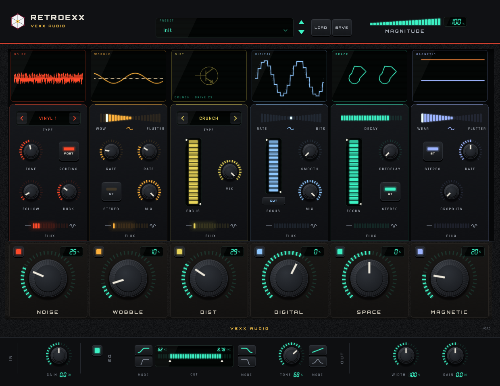
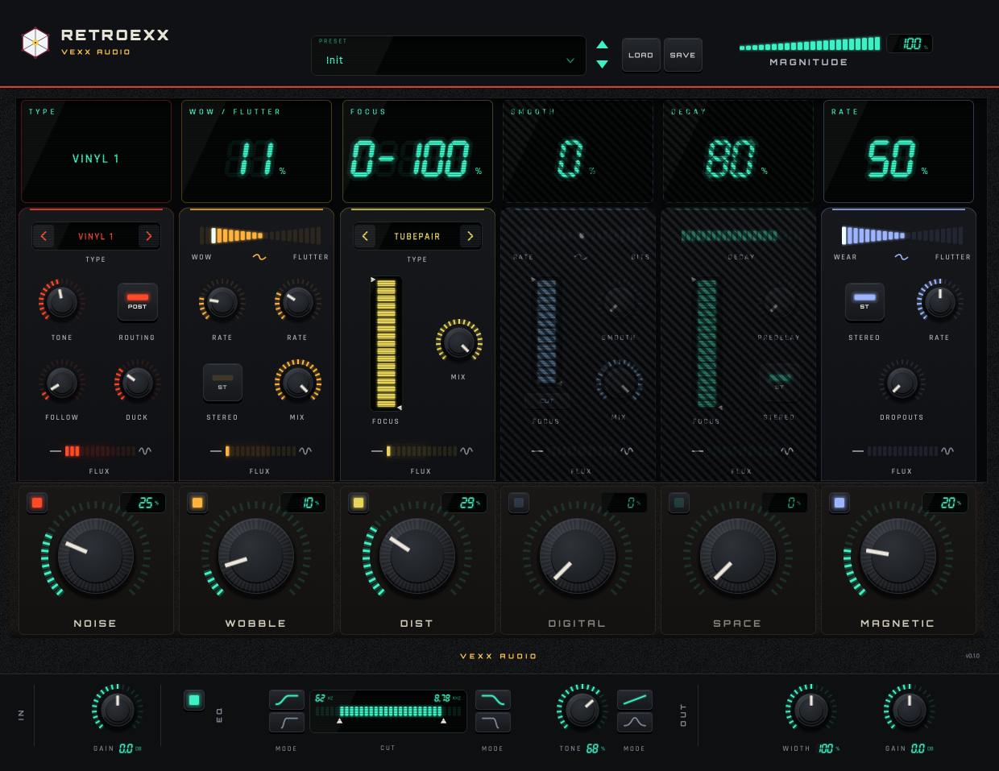

# Retroexx

**Character, noise and space processor** for macOS. AU and VST3, by [Vexx Audio](https://vexxplugins.github.io). · [Product page](https://vexxplugins.github.io/retroexx/)

[](LICENSE)


**[Download Retroexx 0.1.0 for macOS](https://github.com/VexxPlugins/retroexx/releases/latest)**:
universal build with the AU, the VST3 and a standalone app. macOS 12 or newer. Unzip, double click
`Install.command`, done.



Six modules in series across a mix or an instrument: surface noise, wow and flutter, tape wear,
distortion, resolution reduction and space. Each one has its own Amount and Enable; the
**MAGNITUDE** control in the header scales all six macros at once. Below them, a master strip with
cut filters, tone, stereo width and gain.

The engine is C++17 with no dependencies in the core: the graph, the parameters and the scaling
laws are code from this repository. The noise is synthesised here (own PRNG and filters), the
textures are procedural and the presets are original. The plugin loads no third-party assets.

## Modules

| Module | What it does | Controls |
|---|---|---|
| **NOISE** | 16 synthesised noise types: vinyl, tape, cassette, hum, surface | Type, Amount, Tone, Follow, Duck, routing |
| **WOBBLE** | wow and flutter on a fractional delay line, with two LFOs | Amount, WOW⇄FLUTTER, Rate, Mix |
| **MAGNETIC** | tape wear: amplitude modulation and dropouts | Amount, WEAR⇄FLUTTER, Rate, Dropouts, Stereo |
| **DIST** | six saturation stages: tubes, transformer, transistor, clipping | Type, Amount, Mix, filters |
| **DIGITAL** | bit crush and sample-rate reduction with antialiasing | Amount, RATE⇄BITS, Smooth, Mix, filters |
| **SPACE** | 12-resonator bank, four allpass stages and a pre-delay | Amount, Decay, Dampen/Soften, Pre-delay |
| **MASTER** | soft/hard cut filters, tone, stereo width and gain | CUT, TONE, WIDTH, IN/OUT |

## Interface

Every column has a screen. Hovering turns it into a **trip computer** that shows the value of each
control in seven-segment digits, with the parameter name above. The visualisers come from the real
audio of each module (an oscilloscope in NOISE, two L/R energy rings in SPACE, input/output gain in
MAGNETIC) or from the parameters when a module has no audio tap.



The screenshots in this README are generated by the test suite itself (`ctest -R test_ui_snapshot`),
with no retouching.

## Status

The engine is complete, the host surface has **58 parameters**, latency is **64 samples**, state is
own (`RTXX`) and there are 10 factory presets. `auval` passes. With every module active it runs at
**9.5x to 31x** real time on Apple Silicon.

What is still open (the flux signals that link macros to modulation, and the filter position in
DIGITAL and DIST) is declared in [ROADMAP.md](ROADMAP.md) and in the comments of the block it
belongs to. There are no filler values: anything provisional is labelled as such.

## Build

Requirements: macOS (tested on Apple Silicon), CMake 3.22 or newer, and the Xcode toolchain.

```bash
# Core and tests, without JUCE (downloads nothing)
cmake -S . -B build
cmake --build build -j8
ctest --test-dir build

# Plugin AU + VST3 + standalone app (downloads JUCE 8.0.13 the first time)
cmake -S . -B build-juce -DRTXX_WITH_JUCE=ON
cmake --build build-juce -j8
ctest --test-dir build-juce

# Release: universal (Apple Silicon + Intel), what the zip ships
cmake -S . -B build-dist -DRTXX_WITH_JUCE=ON -DCMAKE_BUILD_TYPE=Release \
      -DCMAKE_OSX_ARCHITECTURES="arm64;x86_64"
cmake --build build-dist -j10
```

Mind the architecture: if the `cmake` you use is the Homebrew one (`/usr/local/bin`, x86_64), the AU
is built for x86_64 and a native arm64 `auval` will not load it. Use a native arm64 cmake, or pass
`-DCMAKE_OSX_ARCHITECTURES=arm64`.

## Install

The release zip carries the AU, the VST3 and a standalone app, universal for Apple Silicon and
Intel. `Install.command` copies the two plugin formats into your user folder and clears the
quarantine flag:

```bash
~/Library/Audio/Plug-Ins/Components/Retroexx.component
~/Library/Audio/Plug-Ins/VST3/Retroexx.vst3
```

The build is signed ad hoc, not notarized, because notarization needs a paid Apple Developer
account. macOS will say "unidentified developer" the first time: right click, Open. Nothing here
needs an admin password.

From source:

```bash
cp -R build-dist/src/plugin/Retroexx_artefacts/Release/AU/Retroexx.component \
      ~/Library/Audio/Plug-Ins/Components/
cp -R build-dist/src/plugin/Retroexx_artefacts/Release/VST3/Retroexx.vst3 \
      ~/Library/Audio/Plug-Ins/VST3/
killall AudioComponentRegistrar
auval -v aufx Rtxx Vexx        # AU VALIDATION SUCCEEDED
```

User presets are stored as the same blob the DAW saves, under
`~/Library/Application Support/Vexx Audio/Retroexx/Presets/`.

## Desktop demo

```bash
open build-juce/src/demo/RetroexxDemo_artefacts/Release/RetroexxDemo.app
```

The window is the plugin's **real editor** (the same `AudioProcessor`, not a copy). It has no audio
of its own: to hear the plugin, load it in a DAW. `--screenshot <png>` captures the window without
showing it.

## Layout

```
src/block/    framework: ports, conditions as gains, containers, plugchain DSL
src/gen/      parameter table, graph and chains (generated files)
src/model/    ParamStore: host-to-model laws, host table, factory presets
src/engine/   engine: builds the graph, 64-sample quantum, 64-sample latency
src/blocks/   per-block DSP (Noise, SimpleComp, Wobbler, Flutter, ResoX, BitColor, ...)
src/dsp/      primitives: biquad, delay line, LFO, smoothing, oversampling
src/plugin/   JUCE wrapper (AU/VST3), editor, UI pieces
src/demo/     desktop app with the real editor
tests/        one executable per area; ctest runs them all
tools/        offline render for measuring (WAV in, WAV out)
docs/         the product page, published at vexxplugins.github.io/retroexx
```

## License

**AGPL-3.0-or-later** (see [LICENSE](LICENSE)). It is the license JUCE 8 requires when you publish
source; anything else needs a commercial JUCE license.

Typefaces: Orbitron and Rajdhani, under the SIL Open Font License (see
`src/plugin/ui/assets/fonts/OFL-*.txt`).

RETROEXX, Vexx Audio and the logomark are trademarks of Vexx Audio.
